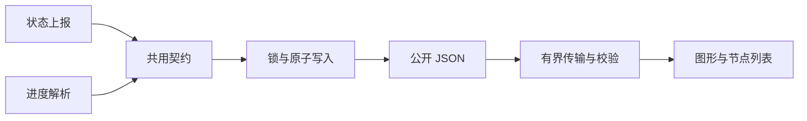
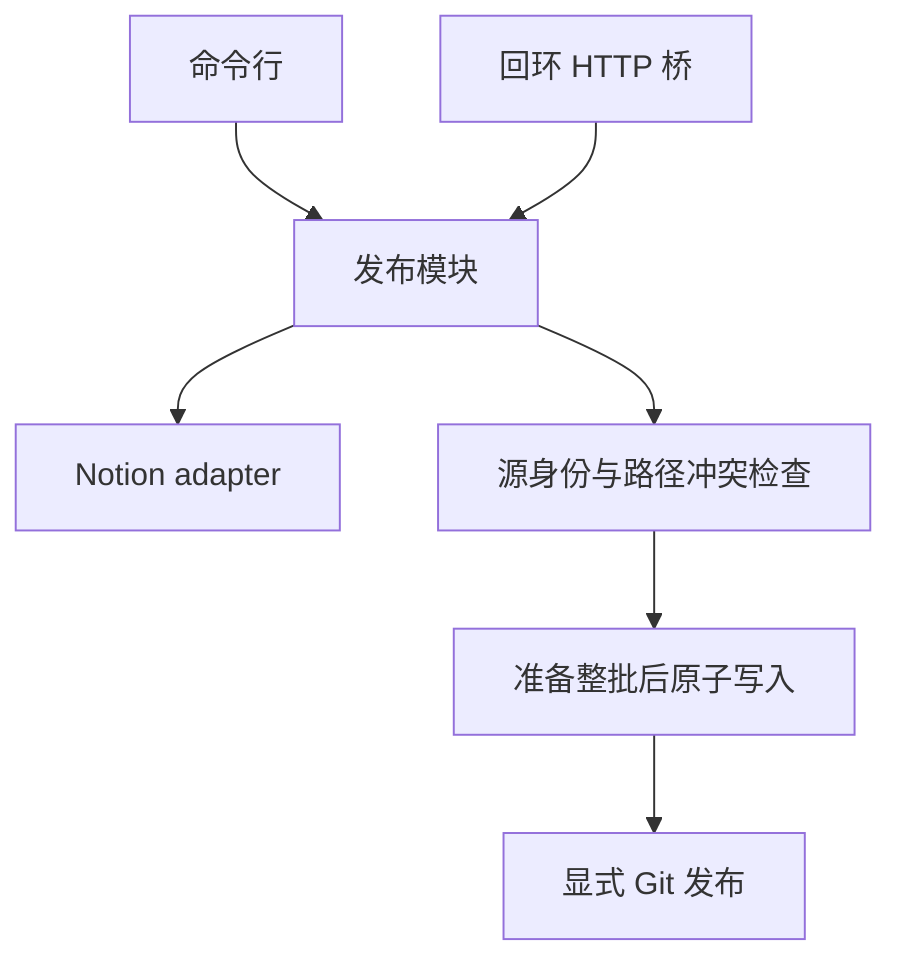

# 发布和数据流程集中校验

本文说明重构后的模块边界，供维护者定位变更。原仓库脚本在导入时执行，发布者重复管理 Git 操作，客户端同时处理拉取、颜色和渲染。这些责任现在按调用边界集中。

## 共用契约减少两端差异

浏览器和 Node 共用状态与进度验证器。上报端投影公开字段，浏览器再次校验读取结果；传输模块只负责超时、取消、大小限制与备用源。颜色读取留在 DOM 模块，数据读取不再依赖 d3。

图形渲染器预建节点与邻接索引，减少逐边查找；动态效果暂停与资源释放由渲染器负责。减少动态效果时先计算稳定布局，页面隐藏或图离开视口时停止动画与模拟。组件只构建语义节点与详情，抽屉保留关闭按钮，节点列表补充 Canvas 的操作入口。

## 发布接口隐藏外部协调

发布模块只提供列表与批量发布。CLI 和网页负责解析选择、展示结果，Notion adapter 负责分页、属性及转换，Git adapter 负责远端与提交范围检查。文件写入使用同一锁和原子替换模块。

比较过的接口包括极小接口、可注册插件的计划执行接口，以及隐藏所有选项的默认调用接口。当前项目只有一种内容源和一种目标，插件接口会增加维护责任；隐藏覆盖和推送会削弱操作控制。因此采用两个操作，保留明确的覆盖与推送参数。

源身份写在文章 frontmatter 中，无需另外维护一份可能不同步的映射。改名时保留原文件和 URL；显式覆盖只允许更新同源文章。读取现有内容目录时发现重复源或 URL 就中止。整批校验先于文章写入，系统错误仍可能留下部分已替换文件，重试按源身份收敛。

Git 发布先要求暂存区为空、目标无本地修改、当前提交与抓取的远端一致。写入后再次检查暂存区和 HEAD，提交只包含目标路径，推送固定提交到已捕获分支。这个选择比隔离分支发布简单，也会在存在未推送开发提交时要求维护者先处理历史。它不阻止用户手动 Git 操作，因此维护者应避免同时编辑目标文件或提交。

## 边界可以直接验证

| 边界 | 验证方式 |
| --- | --- |
| 状态存储 | 多进程真实文件写入、损坏保留、陈旧心跳 |
| 进度解析 | 数字与链接依赖、重复与循环图 |
| Notion adapter | 分页和长属性响应、资格与转换错误样本 |
| 发布模块 | 临时内容目录、改名、冲突、并发及源变化 |
| Git adapter | 临时真实 bare remote，核对提交树 |
| HTTP 桥 | 真实回环请求、访问控制及请求边界 |
| 浏览器 | 构建后的项目路径、桌面与移动视口、详情与释放 |

这些检查证明固定样本的行为。Notion 实际权限、复杂页面转换效果和不同手机的大图性能仍需要实际输入验证。输入预算用于约束资源，不是吞吐或帧率承诺。
